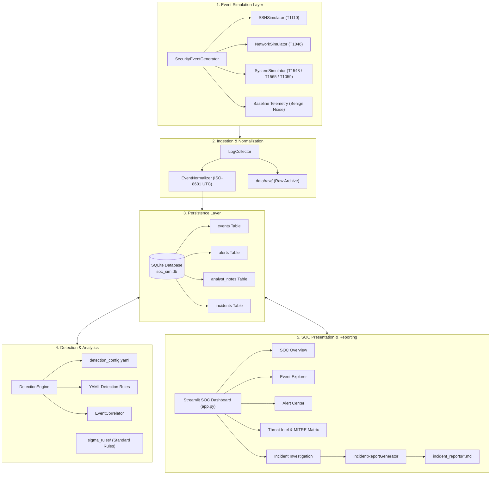

# SOC-SIM System Architecture & Data Flow

SOC-SIM is an educational Security Information and Event Management (SIEM) simulation platform designed to illustrate the end-to-end security operations lifecycle: from telemetry generation and log ingestion to rule-based detection, multi-event correlation, incident investigation, and reporting.

---

## 1. High-Level Architecture Diagram

---

## 2. Component Breakdown

### 2.1 Event Simulation Layer (`simulator/`)
- **`event_generator.py`**: Master orchestrator controlling simulation scenarios and generating normal background telemetry noise.
- **`ssh_simulator.py`**: Simulates automated dictionary attacks and password guessing sequences against SSH daemon.
- **`network_simulator.py`**: Simulates multi-port TCP SYN reconnaissance scans across internal network targets.
- **`system_simulator.py`**: Simulates host-level security violations:
  - Unauthorized sudo execution and shell spawning (`/bin/bash`).
  - Tampering with sensitive authentication databases (`/etc/shadow`, `/etc/passwd`).
  - Interactive reverse shell execution (`bash -i >& /dev/tcp/...`).
- **Telemetry Boundaries:** All source IPs use RFC 5737 documentation blocks (`198.51.100.0/24`, `203.0.113.0/24`, `192.0.2.0/24`) and RFC 1918 private subnets. No live network traffic is dispatched.

### 2.2 Log Collection & Normalization Layer (`ingestion/`)
- **`log_collector.py`**: Ingests raw JSON and JSONL records from disk or memory buffers. Preserves timestamped raw records in `data/raw/` for audit compliance.
- **`normalizer.py`**: Performs schema validation, timestamp normalization to ISO-8601 UTC, IP sanitization, and fallback handling for missing or malformed fields.
- **Deduplication Engine**: Enforces primary key constraints (`event_id`) on SQLite to prevent duplicate log ingestion.

### 2.3 Storage Layer (`database/`)
- **`db_manager.py`**: SQLite database interface operating in Write-Ahead Logging (WAL) mode.
  - `events`: Normalized security events with parsed metadata and indexing on timestamps, source IPs, and event categories.
  - `alerts`: Detected security alerts containing MITRE technique mapping, severity, and supporting event IDs.
  - `analyst_notes`: Forensic observations recorded by SOC analysts.
  - `incidents`: Formal case files linking compound alerts and markdown reports.

### 2.4 Detection & Correlation Engine (`detection/`)
- **`engine.py`**: Rule-based detection engine evaluating sliding time windows and configurable thresholds defined in `config/detection_config.yaml`.
- **`correlation.py`**: Evaluates temporal relationships across disparate logs:
  - Detects failed authentication sequences culminating in successful logins (credential compromise).
  - Correlates multi-stage cyber kill chain attacks (Reconnaissance -> Access -> Privilege Escalation -> Impact).
- **`sigma_rules/`**: Industry-standard Sigma-compatible rule definitions documenting platform detections in standard SIEM interchange format.

### 2.5 SOC Presentation & Case Dossier (`dashboard/` & `incident_reports/`)
- **Streamlit Dark Dashboard**: Professional SOC monitoring interface providing KPI metric cards, Plotly event ingestion timeline charts, severity breakdowns, searchable event explorer, and alert triage.
- **`report_generator.py`**: Compiles structured Markdown incident reports adhering to NIST SP 800-61 / SANS incident handling guidelines.
